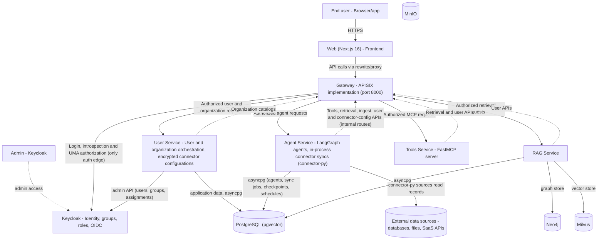
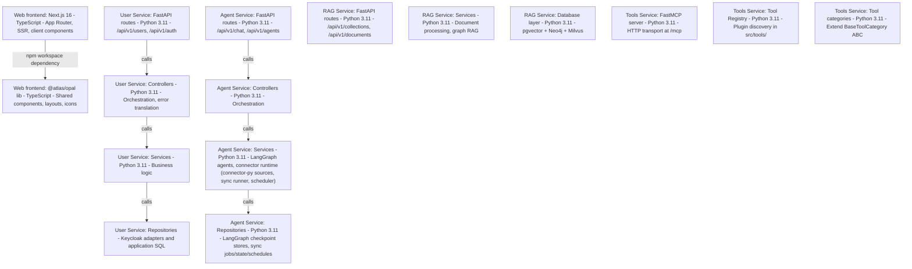
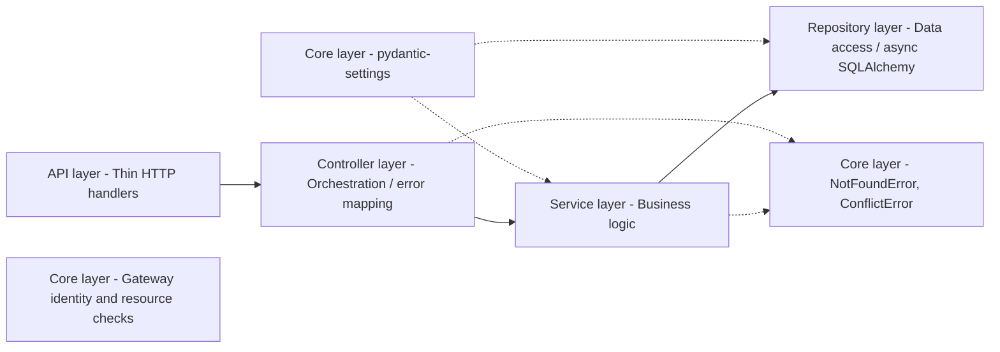
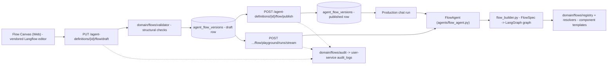

# Architecture Overview

## System context



## Container diagram



## Datasource synchronisation

Datasource syncs run inside agent-service through `packages/connector-py`:
the package holds the source connectors, the sync runner and the scheduler;
there is no separate ingestion deployment. The pieces and their edges:

- A datasource is a rag-service collection plus an agent-service
  `datasource_connections` row naming the connector, the configured streams
  and a pointer to the configuration.
- The connector configuration is stored encrypted per user in user-service
  (`user_connector_configs`). Agent-service reads it through the internal
  gateway route when a sync job starts and never stores it; the browser only
  ever sees it with its secrets masked.
- The runner reads records from the external source and writes them in
  batches to rag-service's ingest routes (`/datasources/{id}/records`, keyed
  by record so a rerun replaces rather than appends); an overwrite sync
  retires the previous run's chunks when it finishes. Incremental checkpoints
  live in `connector_sync_state`, job history in `connector_sync_jobs`, and
  `sync_schedules` drives the scheduler, which claims due runs so that
  several replicas do not start the same sync. Deleting a datasource drops
  its Milvus table through rag-service before the collection row goes.
- Tools-service resolves saved connector tools through agent-service's
  internal connector-tools route, which translates the stored configuration
  into the shape its adapter reads.

Operational limits (concurrency, timeouts, resumption, the upgrade from the
previous ingestion stack) are in [deployment](deployment.md#connector-runtime-upgrade-airbyte-removal).

## Authentication Model

Gateway is the only component that authenticates a caller. It introspects the
token with Keycloak, applies the route's UMA decision, and forwards the result
as trusted headers:

```text
x-gateway-token      shared secret proving the request traversed Gateway
x-gateway-user-id    Keycloak subject
x-gateway-email      email or preferred_username
x-gateway-username   preferred_username
x-gateway-roles      platform realm roles of the token, comma separated
```

Agent-service, RAG-service and tools-service derive identity from those headers
and never contact Keycloak. They do not verify JWT signatures, hold JWKS
clients, or accept API keys, and there is no development or anonymous fallback:
a request without a valid `x-gateway-token` is rejected. Gateway strips all of
these headers from inbound requests before it runs, so a client cannot forge
them.

Machine-to-machine calls keep `x-internal-service-token` and may delegate a user
with `x-user-id`. User-service remains the sole holder of Keycloak Admin API
credentials.

The shared secret is `INTERNAL_SERVICE_TOKEN`, carried under a distinct header
name so Gateway-origin proof stays separate from machine identity.

## Authorization Model

User-service exposes runtime authorization through the existing application
API. Keycloak owns users, groups, composite roles, feature roles, permission
metadata, and assignments. Services and the web app check named permissions;
user-service resolves effective Keycloak roles, including inherited assignments.

- User IDs are Keycloak subjects, and organization IDs are Keycloak group IDs.
- Users can hold multiple composite roles; the primary role is an API projection.
- Composite roles aggregate direct permissions and client feature roles.
- The `system-admin` wildcard role resolves to `["*"]`.
- SQL retains settings, keys, memories, audit records, and resource grants with
  external identity references. It has no runtime identity mirror.

The [identity cutover runbook](../apps/user-service/docs/runbook.md#keycloak-identity-cutover)
covers existing reference and metadata reconciliation before local tables drop.

## Python service layered architecture



**Layer rules:**
- Routes parse HTTP params, call controller, return response. No business logic.
- Controllers orchestrate services, translate domain errors to HTTP statuses.
- Services are pure domain logic. Raise domain exceptions from `core/exceptions.py`.
- Repositories wrap SQLAlchemy async sessions. Each entity has its own repo.
- Config loaded via `pydantic-settings` `BaseSettings` with `@lru_cache`.
- Services/controllers: `_instance` module var + `get_*()` singleton pattern.

## Development lifecycle

```mermaid
flowchart LR
  Start([Start])
  Understand["Load skill + read AGENTS.md"]
  Code["Follow layered architecture"]
  Test["make test / npm test"]
  Lint["make lint"]
  Typecheck["make typecheck / npm run types:check"]
  Validate["make validate"]
  QualityGate["make quality-staged"]
  Push["make quality-push"]
  Done([Done])

  Start --> Understand
  Understand --> Code
  Code --> Test
  Test --> Lint
  Lint --> Typecheck
  Typecheck --> Validate
  Validate --> QualityGate
  QualityGate --> Push
  Push --> Done
```



## Infrastructure & startup

```mermaid
flowchart LR
  env_init["1. Env setup: provide configs/.env"]
  env_check["1. Env setup: make env-check"]
  dc_services["2. Infrastructure: docker compose up"]
  PG["Postgres"]
  Neo4j["Neo4j"]
  Milvus["Milvus"]
  KC["Keycloak"]
  dc_dev["3. App services: docker compose up"]
  User["User Service"]
  Agent["Agent Service"]
  RAG["RAG Service"]
  Tools["Tools Service"]
  APISIX["APISIX Gateway"]

  env_init --> env_check
  env_check --> dc_services

  dc_services --> PG
  dc_services --> Neo4j
  dc_services --> Milvus
  dc_services --> KC

  dc_services --> dc_dev

  APISIX --> User
  APISIX --> Agent
  APISIX --> RAG
  APISIX --> Tools

  User --> PG
  Agent --> PG
  RAG --> PG
   RAG --> Neo4j
   RAG --> Milvus

## Agent service composition

Agents in the agent-service are composed from explicit components (brain,
perceptrons, tool gateway, graph schema, runtime policies) through the
`agent_composition` package — `AgentFactory` → `AgentComposer` → `ComposedAgent`
— rather than monolithic agent modules. Built-in agents are recipes; LangGraph
Studio graphs are exposed from `src/agents/studio_graphs.py`. See
[agent composition](../apps/agent-service/docs/agent-composition.md) for the
full runtime reference and the list of legacy modules removed in ASC-7.

```

### Visual Flow Canvas Execution Architecture



- Drafts are mutable and never touch what production runs; publishing promotes
  a validated draft to an immutable `agent_flow_versions` row (rollback creates
  a new version from an older one rather than mutating history).
- The playground executes the current draft (or an unsaved inline spec) via a
  separate `run_kind="playground"` thread namespace, isolated from production
  chat runs but sharing the same `FlowAgent` compilation path.
- Every draft save, publish, rollback, and playground run emits a `flow:*`
  audit event to user-service's shared `audit_logs` table (P3 Task 19).
